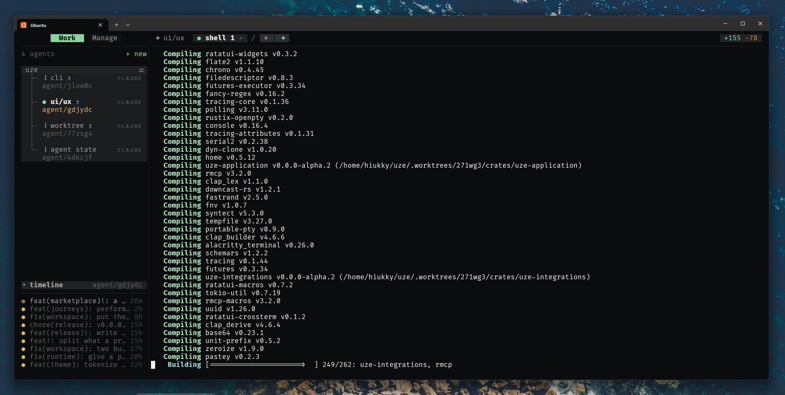

<h1 align="center">.dotfiles</h1>

<p align="center">
  
</p>

<p align="center">
  <a href="https://www.chezmoi.io">
    
  </a>
  <a href="https://uze.hiukky.com">
    
  </a>
  <a href="https://www.zsh.org/">
    
  </a>
  <a href="https://ubuntu.com/wsl">
    
  </a>
  <a href="https://www.microsoft.com/windows">
    
  </a>
</p>

<br>

## 🚀 Install

**🐧 Linux / WSL**

```sh
sh -c "$(curl -fsLS https://hiukky.com/setup.sh)"
```

**🪟 Windows** (works even with no WSL yet), from a normal PowerShell:

```powershell
irm https://hiukky.com/setup.ps1 | iex
```

Same command every time on either OS: first run bootstraps everything from scratch, later runs just pull and apply updates.

## 📦 What it installs

One idempotent pass provisions both sides of the machine. Linux gets the shell and the toolchain, the Windows host gets the apps that need the GPU or the desktop.

**🐧 Linux / WSL**

| | |
| --- | --- |
| 🐚 Shell | `zsh`, `zinit`, `starship` |
| 🧰 CLI | `eza`, `bat`, `ripgrep`, `fd`, `fzf`, `tree`, `jq`, `gh`, `glab`, `glow`, `rtk`, `asciinema` |
| ✏️ Editor | `vim` as `$EDITOR` |
| ⚙️ Runtimes | `node`, `rust`, `bun`, `flutter`, all via `mise` |
| 🐳 Containers | `docker` (BuildKit cache capped), `kubectl`, `kind` |
| 🤖 Agents | `claude`, `codex`, `opencode`, [`uze`](https://uze.hiukky.com) built from `~/uze` |
| 🔑 Accounts | fresh SSH key per machine, `gh` / `glab` / `claude` login |

**🪟 Windows host**

| | |
| --- | --- |
| 🖥️ Apps | Discord, Notion, Steam, Spotify, Teams, VLC, CapCut, Chrome, and more |
| 🧪 Virtualization | VirtualBox, Windows Sandbox, Android SDK |
| 🧠 Local inference | `llama.cpp` + `llmfit`, native for direct GPU access |
| 🎮 Controller | 8BitDo Ultimate 2.4G tools (Ultimate Software, Pair Tools, Firmware Updater) |
| 🔤 Fonts | pinned Nerd Font catalog (`nerd-font-lab` to check them) |
| 🔄 Synced from WSL | `.wslconfig`, Windows Terminal `settings.json` |
| 🔋 Power | `idle-guard`: vetoes sleep while WSL is working, since Windows only watches the keyboard and mouse |

## 🛠️ Usage

**chezmoi**

| Command | What it does |
| --- | --- |
| `chezmoi add ~/.zshrc` | Start tracking an existing file |
| `chezmoi edit ~/.zshrc` | Edit the managed version of a file |
| `chezmoi diff` | Preview what would change |
| `chezmoi apply` | Apply changes to `$HOME` |
| `chezmoi update` | Pull the latest changes and apply |

**idle-guard**

| Command | What it does |
| --- | --- |
| `idle-guard status` | Why the machine is (or isn't) being held awake |
| `idle-guard report` | What kept it awake lately, and how much it slept |
| `idle-guard inhibit 2h` | Hold it awake for a while (`release` drops the hold) |

📄 Conventions, design decisions and every gotcha: [`AGENTS.md`](./AGENTS.md).

## 💻 My setup

| | |
| --- | --- |
| 🧠 CPU | AMD Ryzen 7 5700G |
| 🎮 GPU | NVIDIA GeForce RTX 4060 Ti |
| 🧵 RAM | 64 GB |
| 💾 Storage | 1 TB NVMe + 240 GB SATA SSD |
| 🖥️ OS | Windows 11 + WSL2 (Ubuntu 24.04) |

<p align="center">
  <sub>feito com 🖤 por <a href="https://github.com/hiukky">hiukky</a></sub>
</p>
